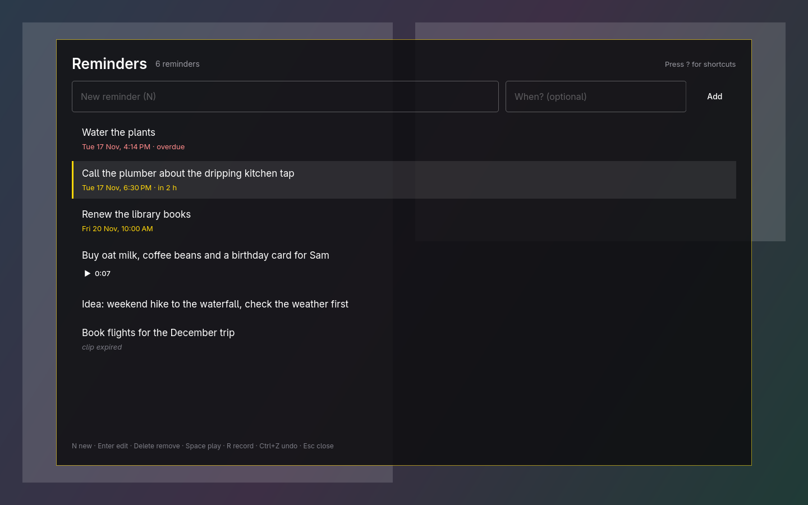
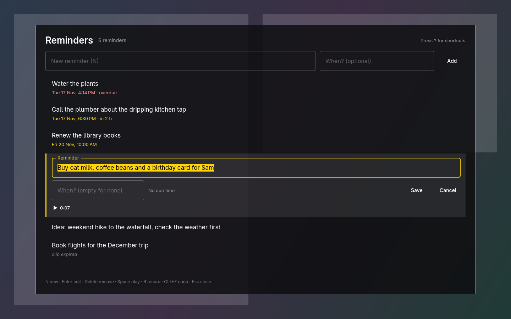

# Omni Reminder



A see-through reminder list for [Omarchy](https://omarchy.org), on one key:

- **Tap** `Ctrl + Shift + Alt + R` to show or hide your reminders.
- **Hold** it and speak: when you let go, the clip is transcribed by
  [Superwhisper](https://superwhisper.com) and becomes a new reminder, with
  the voice clip attached. The overlay opens with it ready to edit.

Reminders can have a due time. When one is due you get a desktop
notification, also after a reboot (an overdue reminder notifies once when the
daemon starts). Everything is stored on your machine.


## Keys

The global shortcut works anywhere. Either Shift key works: Hyprland does not
tell left from right Shift in a binding.

| Key | Action |
| --- | --- |
| `Ctrl + Shift + Alt + R` (tap) | Show or hide the overlay |
| `Ctrl + Shift + Alt + R` (hold) | Record a voice memo while held (up to 5 minutes) |

In the overlay:

| Key | Action |
| --- | --- |
| `N` | New reminder (Tab to its time, Enter to add) |
| `↑` `↓` / `K` `J` | Move the selection |
| `Enter` / `E` | Edit the selected reminder (Enter saves, Shift+Enter is a new line, Esc cancels) |
| `Delete` / `D` | Remove it (asks first: press again or Enter) |
| `Space` / `P` | Play or pause its voice clip |
| `R` | Start or stop a voice memo from the overlay |
| `Ctrl + Z` / `Ctrl + Shift + Z` | Undo / redo |
| `Esc` / `Q` | Close the overlay |
| `?` | Show every shortcut |



### Due times

The time field reads what people type: `18:30` (today, or tomorrow if that has
passed), `9pm`, `tomorrow`, `tomorrow 8:15`, `today 23:00`, `+10m`, `+2h`,
`+3d`, `in 10 min`, `2026-12-01 14:00`, or any ISO 8601 time. Leave it empty
for a plain list item.

## Voice clips

Clips are Opus in an Ogg file, mono, 32 kbit/s (about 240 kB a minute).
They are kept for a limited time and space:

- each clip is deleted **30 days** after it was recorded;
- when all clips together pass **100 MB** (10^8 bytes), the oldest are deleted
  first until the rest fit.

The reminder itself stays and shows "clip expired". The cleanup runs when the
daemon starts, after every new recording, and every six hours.

If Superwhisper is missing, fails, or hears nothing, the reminder is still
added, titled "Voice memo" and the time, and the overlay says what went wrong.
Transcription uses whatever mode Superwhisper is set to (offline or cloud);
Omni Reminder never changes Superwhisper's settings.

## Data

```text
~/.local/share/omni-reminder/
├── reminders.json   saved atomically (written beside, then renamed)
└── clips/           the voice clips
```

## Command line

Every command exits 0 on success and 1 on failure, with the reason on stderr.

```bash
omni-reminder open                       # show the overlay (starts the daemon if needed)
omni-reminder daemon                     # the background process (autostarted)
omni-reminder list --json
omni-reminder add "Call the dentist" --due 2026-12-01T14:00
omni-reminder remove 7                   # also deletes its clip
omni-reminder key-down | key-up          # what the global shortcut runs
omni-reminder skill install              # a short skill so coding agents can use it
```

## How the shortcut works

Hyprland runs `omni-reminder key-down` on press and `omni-reminder key-up` on
release (Omarchy's `o.bind_hold`, whose release half fires even if the
modifiers are let go first). Both hand their own start time to the daemon over
a local socket in `$XDG_RUNTIME_DIR`; under 400 ms is a tap, longer is a hold.
The microphone starts on the press, so the first words are not lost, and a tap
throws that audio away. If a release ever goes missing, the recording stops at
5 minutes, at the next press, or with Stop in the badge or overlay.

## Install

Needs Omarchy (Hyprland, PipeWire) with `qt6-base`, `qt6-declarative`,
`qt6-wayland`, `qt6-multimedia`, `ffmpeg` and `libnotify`, and optionally
Superwhisper for transcription.

```bash
bin/install            # builds, packages, and installs with pacman
```

Then add to `~/.config/hypr/bindings.lua`:

```lua
o.bind_hold("CTRL + SHIFT + ALT + R", "Omni Reminder (tap: reminders, hold: voice memo)", "omni-reminder key-down", "Omni Reminder: finish voice memo", "omni-reminder key-up")
```

to `~/.config/hypr/autostart.lua`:

```lua
o.launch_on_start("omni-reminder daemon")
```

and to `~/.config/hypr/hyprland.lua`, so the overlay floats above everything:

```lua
o.window({ class = "^omni-reminder$", title = "^Omni Reminder$" }, {
  float = true, pin = true, center = true,
  size = { "(monitor_w*0.7)", "(monitor_h*0.75)" },
  dim_around = true,
})
o.window({ class = "^omni-reminder$", title = "^Omni Reminder Recording$" }, {
  float = true, pin = true, size = { 400, 84 },
  move = { "((monitor_w-window_w)*0.5)", "(monitor_h*0.05)" },
  no_initial_focus = true, border_size = 0,
})
```

Check with `hyprctl reload && hyprctl configerrors`.

## Develop

```bash
bin/build    # qmake6 + make into build/omni-reminder
bin/test     # Qt Test, offscreen: store, retention, tap/hold, due times, transcription
```

C++ and Qt Quick, the way Omarchy's own apps are built. It follows the
Omarchy theme accent and window rounding live, and the language picked in
Omarchy (English and Bengali so far: add `src/i18n/<code>.json`).

## License

MIT. The theme and language classes follow Omacut and Monologue by David
Heinemeier Hansson (MIT).
