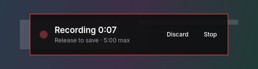

# Omni Reminder


A see-through reminder list for [Omarchy](https://omarchy.org), on one key:

- **Tap** `Ctrl + Shift + Alt + R` to show or hide your reminders.
- **Hold** it and speak: when you let go, the clip is transcribed by
  [Superwhisper](https://superwhisper.com) and becomes a new reminder, with
  the voice clip attached. The overlay opens with it ready to edit.

Reminders can have a due time. When one is due you get a desktop
notification, also after a reboot (an overdue reminder notifies once when the
daemon starts). Everything is stored on your machine; if you want, the text
and times can also sync with your Google account so they show on your phone
(see [Google sync](#google-sync-iphone-and-other-phones)). Voice clips never
leave the computer.



## Keys

The global shortcut works anywhere. Either Shift key works: Hyprland does not
tell left from right Shift in a binding.

| Key | Action |
| --- | --- |
| `Ctrl + Shift + Alt + R` (tap) | Show or hide the overlay |
| `Ctrl + Shift + Alt + R` (hold) | Record a voice memo while held (up to 5 minutes) |

In the overlay:

| Key | Action |
| --- | --- |
| `N` | New reminder (Tab to its time, Enter to add) |
| `↑` `↓` / `K` `J` | Move the selection |
| `Enter` / `E` | Edit the selected reminder (Enter saves, Shift+Enter is a new line, Esc cancels) |
| `X` | Mark it done (struck through, sorted last), or not done again |
| `Delete` / `D` | Remove it (asks first: press again or Enter) |
| `Space` / `P` | Play or pause its voice clip |
| `R` | Start or stop a voice memo from the overlay |
| `Ctrl + Z` / `Ctrl + Shift + Z` | Undo / redo |
| `Esc` / `Q` | Close the overlay |
| `?` | Show every shortcut |


### Due times

The time field reads what people type: `18:30` (today, or tomorrow if that has
passed), `9pm`, `tomorrow`, `tomorrow 8:15`, `today 23:00`, `+10m`, `+2h`,
`+3d`, `in 10 min`, `2026-12-01 14:00`, or any ISO 8601 time. Leave it empty
for a plain list item.

## Voice clips

Clips are Opus in an Ogg file, mono, 32 kbit/s (about 240 kB a minute).
They are kept for a limited time and space:

- each clip is deleted **30 days** after it was recorded;
- when all clips together pass **100 MB** (10^8 bytes), the oldest are deleted
  first until the rest fit.

The reminder itself stays and shows "clip expired". The cleanup runs when the
daemon starts, after every new recording, and every six hours.

If Superwhisper is missing, fails, or hears nothing, the reminder is still
added, titled "Voice memo" and the time, and the overlay says what went wrong.
Transcription uses whatever mode Superwhisper is set to (offline or cloud);
Omni Reminder never changes Superwhisper's settings.

## Data

```text
~/.local/share/omni-reminder/
├── reminders.json   saved atomically (written beside, then renamed)
├── clips/           the voice clips
├── sync.json        Google sync bookkeeping: ids and what both sides last agreed on
└── sync-status.json the last sync result (for the overlay and `sync status`)

~/.config/omni-reminder/
├── google-client.json   your own OAuth client (you download it, see below)
└── google-token.json    the sign-in, only if no desktop keyring is available (mode 0600)
```

## Command line

Every command exits 0 on success and 1 on failure, with the reason on stderr.

```bash
omni-reminder open                       # show the overlay (starts the daemon if needed)
omni-reminder daemon                     # the background process (autostarted)
omni-reminder list --json
omni-reminder add "Call the dentist" --due 2026-12-01T14:00
omni-reminder remove 7                   # also deletes its clip
omni-reminder key-down | key-up          # what the global shortcut runs
omni-reminder skill install              # a short skill so coding agents can use it
omni-reminder sync login                 # connect a Google account (opens the browser)
omni-reminder sync status [--json]       # last sync, errors, changes waiting
omni-reminder sync now                   # sync right away
omni-reminder sync logout                # disconnect and forget the sign-in
```

## Google sync (iPhone and other phones)

Optional. Once set up, reminders with a due time become events in a calendar
called **Omni Reminder**, each with a pop-up alert at the due time; reminders
without a time (and finished ones) become tasks in a task list called **Omni
Reminder**. It works both ways: add, edit, tick off or delete on the phone and
it shows up here within a few minutes, and the other way round.

- **Only the reminder text, its due time, and whether it is done are sent.**
  No audio, no clip names, no other details of a voice memo. A reminder that
  comes from the phone has no clip.
- The app only touches the calendar and the task list it created. It asks
  Google for the narrowest permissions that allow that:
  `calendar.app.created` (calendars this app creates, and their events; it
  cannot even see your other calendars) and `tasks` (Google has no narrower
  Tasks permission).
- When both sides changed the same reminder between two syncs, the newer edit
  wins. A change here beats a deletion on the phone (the reminder goes back up);
  a deletion on the phone of an unchanged reminder deletes it here too.
- Giving a reminder a time moves it from Tasks to Calendar; removing the time,
  or ticking it off, moves it back. A task given a date on the phone (Tasks has
  dates, not times) becomes a reminder at 09:00 that day and moves to the
  calendar, so it gets an alert.
- The daemon syncs about 3 seconds after a change, every 3 minutes, and on
  `omni-reminder sync now`. Without network nothing is lost or blocked: changes
  wait, and it retries after 30 s, 1, 2, 4, 8, then every 15 minutes. The
  overlay header shows the state ("Google: synced 14:05", "offline, 2 changes
  waiting", or in red when you need to sign in again).

### One-time setup: your own Google OAuth client

Google requires every app that reads a calendar to be registered. You register
your own copy (free, about 10 minutes); nobody else gets access.

1. Open the [Google Cloud console](https://console.cloud.google.com/), and
   create a new project (project picker at the top, **New project**), for
   example "omni-reminder".
2. Enable both APIs for that project: **APIs & Services > Library**, search for
   **Google Calendar API**, **Enable**; then the same for **Google Tasks API**.
3. Set up the consent screen: **Menu > Google Auth platform > Branding**,
   **Get started**. App name "Omni Reminder", your e-mail as support e-mail;
   **Audience: External**; your e-mail as contact; accept the policy, **Create**.
4. Add yourself as a test user: **Google Auth platform > Audience > Test users >
   Add users**, enter the Gmail address whose calendar you want to use, **Save**.
5. Create the client: **Google Auth platform > Clients > Create client**,
   Application type **Desktop app**, any name, **Create**.
6. In the dialog that follows (or from the client's row in the list), use
   **Download JSON** and save it as `~/.config/omni-reminder/google-client.json`:

   ```bash
   mkdir -p ~/.config/omni-reminder
   mv ~/Downloads/client_secret_*.json ~/.config/omni-reminder/google-client.json
   chmod 600 ~/.config/omni-reminder/google-client.json
   ```
7. Sign in: `omni-reminder sync login`. Your browser opens Google's page. Pick
   the account, click through the "Google hasn't verified this app" screen
   (**Advanced > Go to Omni Reminder (unsafe)**: it is your own app), leave
   **both** permission boxes ticked, **Continue**. The tab then says "Omni
   Reminder is signed in", and the first sync starts.

Check it with `omni-reminder sync status`.

#### Important: the weekly sign-in of "Testing" apps

While the app's publishing status is **Testing** (the default), Google lets
every sign-in expire **7 days** after you gave consent, and the refresh token
with it ([Google: OAuth 2.0, refresh token expiration](https://developers.google.com/identity/protocols/oauth2#expiration);
[Google Cloud help: manage app audience](https://support.google.com/cloud/answer/15549945)).
Omni Reminder then shows "not signed in" in red and you would have to run
`omni-reminder sync login` every week.

To avoid that, set the status to **In production**: **Google Auth platform >
Audience > Publish app**, confirm. For a personal app like this you do not
need to submit it for verification. The consequences:

- the "Google hasn't verified this app" warning stays on the sign-in page
  (click through it as in step 7);
- an unverified app can be used by at most 100 accounts in total, which does
  not matter for one person;
- sign-ins no longer expire after 7 days; they last until you sign out,
  revoke the access at <https://myaccount.google.com/permissions>, or do not use
  it for six months.

Run `omni-reminder sync login` once more after switching, to get a sign-in
that does not expire. (Calendar permissions are usually classed by Google as
"sensitive"; the label of each is shown under **Google Auth platform > Data
Access**. Sensitive permissions are why the warning screen appears.)

### On the iPhone

- **Calendar (timed reminders):** Settings > Apps > Calendar > Calendar
  Accounts > Add Account > Google (on older iOS: Settings > Calendar >
  Accounts), sign in with the same Google account, and keep **Calendars**
  switched on. Make sure the **Omni Reminder** calendar is ticked in the
  Calendar app's **Calendars** list. The pop-up alert at the due time comes from
  the event; iOS shows it like any calendar alert.
- **Tasks (reminders without a time):** install **Google Tasks** from the App
  Store and sign in with the same account; the list is called **Omni
  Reminder**. (The built-in Reminders app does not show Google Tasks.)

### Where the sign-in is kept

In the desktop keyring (GNOME Keyring through the Secret Service, via
`secret-tool`), which Omarchy runs: there it is encrypted on disk and unlocked
with your login. If no keyring answers, it falls back to
`~/.config/omni-reminder/google-token.json` with permissions 0600 (only you can
read it). Only the refresh token is stored; access tokens live in memory for
an hour. `omni-reminder sync logout` revokes it at Google and deletes it here.
Neither the client file nor the sign-in is ever inside this repository
(`.gitignore` blocks both).

## How the shortcut works

Hyprland runs `omni-reminder key-down` on press and `omni-reminder key-up` on
release (Omarchy's `o.bind_hold`, whose release half fires even if the
modifiers are let go first). Both hand their own start time to the daemon over
a local socket in `$XDG_RUNTIME_DIR`; under 400 ms is a tap, longer is a hold.
The microphone starts on the press, so the first words are not lost, and a tap
throws that audio away. If a release ever goes missing, the recording stops at
5 minutes, at the next press, or with Stop in the badge or overlay.

## Install

Needs Omarchy (Hyprland, PipeWire) with `qt6-base`, `qt6-declarative`,
`qt6-wayland`, `qt6-multimedia`, `ffmpeg` and `libnotify`, and optionally
Superwhisper for transcription.

```bash
bin/install            # builds, packages, and installs with pacman
```

Then add to `~/.config/hypr/bindings.lua`:

```lua
o.bind_hold("CTRL + SHIFT + ALT + R", "Omni Reminder (tap: reminders, hold: voice memo)", "omni-reminder key-down", "Omni Reminder: finish voice memo", "omni-reminder key-up")
```

to `~/.config/hypr/autostart.lua`:

```lua
o.launch_on_start("omni-reminder daemon")
```

and to `~/.config/hypr/hyprland.lua`, so the overlay floats above everything:

```lua
o.window({ class = "^omni-reminder$", title = "^Omni Reminder$" }, {
  float = true, pin = true, center = true,
  size = { "(monitor_w*0.7)", "(monitor_h*0.75)" },
  dim_around = true,
})
o.window({ class = "^omni-reminder$", title = "^Omni Reminder Recording$" }, {
  float = true, pin = true, size = { 400, 84 },
  move = { "((monitor_w-window_w)*0.5)", "(monitor_h*0.05)" },
  no_initial_focus = true, border_size = 0,
})
```

Check with `hyprctl reload && hyprctl configerrors`.

## Develop

```bash
bin/build    # qmake6 + make into build/omni-reminder
bin/test     # Qt Test, offscreen: store, retention, tap/hold, due times, transcription,
             # and Google sync against a fake Google server (no real account needed)
```

C++ and Qt Quick, the way Omarchy's own apps are built. It follows the
Omarchy theme accent and window rounding live, and the language picked in
Omarchy (English and Bengali so far: add `src/i18n/<code>.json`).

## License

MIT. The theme and language classes follow Omacut and Monologue by David
Heinemeier Hansson (MIT).
